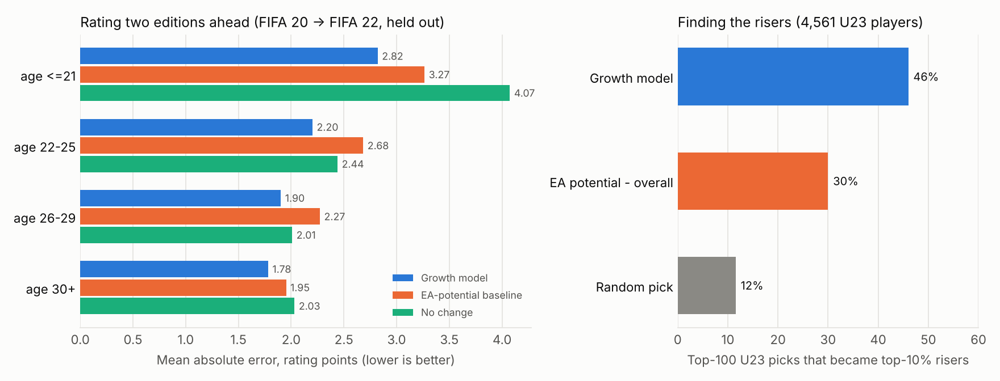

# Career Mode Scout

Data-driven transfer planning for EA FC / FIFA career mode, built on eight editions of
sofifa player data (FIFA 15 – FIFA 22, ~139k player-seasons).

Three tools, one Streamlit app:

| Tool | What it answers | How |
|---|---|---|
| **Growth forecaster** | "What will this player be rated next year, and the year after?" | Gradient boosting on 85k player-season transitions, edition-based backtest |
| **Squad builder** | "Who should I buy (and sell) with €X and a wage cap to get the best XI?" | Mixed-integer program solved exactly with HiGHS |
| **Replacement finder** | "Who plays like my star but costs half as much?" | Similarity search over standardised attribute profiles (FAISS / NumPy) |

I built it because I play a lot of career mode and kept making transfer decisions on
gut feeling and the potential number EA shows. The question was whether a model trained
on how EA actually re-rated players over eight years could do better.



## Results (all on data the models never saw)

### Growth forecaster
Test editions are held out by time: the model that predicts FIFA 22 ratings is trained only
on transitions whose targets were known before FIFA 22.

| Mean absolute error (rating points) | 1 edition ahead (FIFA 21 → 22) | 2 editions ahead (FIFA 20 → 22) |
|---|---|---|
| No change (persistence) | 1.76 | 2.65 |
| Age curve | 1.70 | 2.56 |
| **EA-potential baseline** (linear model on POT − OVR × age, fitted on the same data) | 1.69 | 2.59 |
| **Growth model** | **1.61** (−4.4%) | **2.20** (−15.1%) |

* Players aged 21 or younger, 2 editions ahead: 2.82 vs 3.27 for the EA-potential baseline (−14%).
* **Finding the risers.** Among 4,561 players aged 23 or younger in FIFA 20, the model's top-100
  predicted risers contained **46** of the top-10% actual 2-year improvers, against 30 when ranking
  by EA's potential gap (and 12 by chance). Their average 2-year gain was +6.8 vs +5.6.
* The 80% prediction band covers 92% (1 edition) / 90% (2 editions) of outcomes once rounded
  to whole ratings, so it is a little conservative.
* Where it does not help: for players 26 and older one edition ahead, "no change" is as good
  or better (26–29: 1.32 vs 1.37; 30+: 1.26 vs 1.30). The gain is in players under 26.

### Squad builder
**Exact vs. a hand-made strategy** — every Premier League club in FIFA 22 × budgets of
€20M / €50M / €100M × 4-3-3 and 4-2-3-1 (120 scenarios, max 3 signings, wage cap = current
bill + 15%). The greedy strategy repeatedly buys the biggest affordable upgrade (or the best
upgrade per euro; the better of the two is used).

* The MILP was never worse and strictly better in **60%** of scenarios.
* It added **19.4** rating points to the XI on average vs **17.1** for the best greedy plan
  (**+13.6%** more improvement from the same money).
* Median solver time **0.6 s** (max 2.7 s) over the full transfer market (~18k players).

**Do forecasts make better signings?** Only modestly, and a simpler potential-based adjustment did better in this test — see [Decision backtest](#decision-backtest).

### Replacement finder
* **Identity check:** taking each player's FIFA 21 attributes and searching the FIFA 22
  database, the nearest profile is the same player 82% of the time (12,045 outfield players).
  The vectors capture who a player is, not just his rating.
* 53% of a player's 10 nearest neighbours share his primary position (11% by chance).
* For 89% of the 128 Premier League players rated 80+, it finds a same-position player within
  3 rating points at ≤ 50% of the price: on average 63% cheaper for a 1.7-point drop.

## How it works

### Data
`scripts/download_data.py` fetches the raw files from public GitHub mirrors of the Kaggle
"FIFA complete player dataset" (scraped from sofifa.com), pinned to commits and checked by
MD5. FIFA 15–20 and 22 use the Kaggle layout; FIFA 21 comes from a cleaned sofifa export with
different column names. `fcscout/data.py` maps every layout to one schema (it also reads the
FC 24 combined `male_players.csv`), parses values like `89+2` / `91-1`, treats €0 values as
missing and blanks outfield face stats for keepers so every edition means the same thing.

### Forecaster (`fcscout/features.py`, `fcscout/forecast.py`)
One row per player per edition; target = overall rating 1 or 2 editions later.
Features, all known at prediction time and present in every edition:
age, overall, potential, gap, all 29 detailed attributes + GK attributes, face stats,
value/wage (value relative to the edition median), contract years left, loan status,
**club strength** (mean of the club's top 16), **rank in the squad and in his position group**
(a proxy for minutes), and **momentum** (rating and potential change over the last one and two
editions).

The model is scikit-learn `HistGradientBoostingRegressor` predicting the *change* in rating with
an absolute-error loss (a median forecast; on the validation editions it beat squared error
because year-to-year shifts are skewed). Two quantile models give the 10%/90% band.
Hyperparameters are tuned on a validation edition that is also strictly earlier than the test
edition.

### Squad builder (`fcscout/optimize.py`)
```
maximise    Σ r[p,k]·y[p,k]                      r = the player's rating at that position
subject to  Σ_p y[p,k] = 1          every XI slot filled
            Σ_k y[p,k] ≤ x[p]       a player starts at most once, only if in the squad
            Σ fees(buys) − Σ fees(sales) ≤ transfer budget
            Σ wages(final squad) ≤ wage budget
            #buys ≤ max signings,  #sales ≤ max sales,  squad size and depth per position
            x, y binary
```
`r` is sofifa's position rating (a striker at LW is rated as a LW), optionally plus the
forecast change, so the same solver can optimise for today, next season or two seasons out.

The full market is too large to hand to the solver directly (~200k binaries hit the time
limit), so it is reduced with two rules that provably cannot remove the optimum:
1. a signing rated below the (11 + max sales)-th best squad option at a slot never needs to
   start there — one of those squad players is always free to take the slot;
2. a player beaten on every slot rating, fee and wage by at least *max signings* others in his
   position group can always be swapped for one of them.

This leaves roughly 1–2.5k candidates; a plan takes a few seconds including the pruning. The unit tests check the result
against brute-force enumeration on random small instances, with and without sales.

### Replacement finder (`fcscout/similar.py`)
Players are vectors of their 29 outfield attributes (keepers: GK attributes plus a few
relevant others), z-scored and L2-normalised; inner product = cosine similarity. Search is
exact — FAISS `IndexFlatIP` when installed, otherwise the same computation in NumPy — then
filtered by position, fee, age, rating and league.

## Decision backtest
Does planning with the forecast lead to better signings? For each test window, 40 clubs
(top-16 average 68–78) get €30M, 3 signings and a 4-3-3. Signings are chosen three ways —
on today's position ratings (**now**), with the EA-potential baseline's predicted change
(**potential**), and with the growth model's (**forecast**) — using models trained only on
earlier editions. Each plan is then scored with the **actual** ratings one or two editions
later: the best XI the final squad can field (players who left the game are unavailable).
All four variants that were run are reported.

| Variant (windows) | Clubs | Forecast − now, XI points [95% CI] | Forecast − potential | Signing age (now / pot. / fc.) | Signings gone from the game (now / pot. / fc.) |
|---|---|---|---|---|---|
| 1 season (FIFA 18, 19) | 76 | +0.3 [-0.6, +1.2] | -0.4 | 33.1 / 32.1 / 32.6 | 31 / 29 / 34 |
| 1 season, signings ≤ 29 | 76 | -0.1 [-0.7, +0.6] | -0.7 | 27.9 / 27.1 / 27.7 | 43 / 42 / 48 |
| 2 seasons (FIFA 18, 20) | 74 | +1.6 [-0.1, +3.2] | -1.4 | 33.3 / 29.7 / 31.8 | 109 / 88 / 97 |
| 2 seasons, signings ≤ 29 | 74 | +2.5 [-0.1, +5.5] | -2.2 | 28.2 / 22.2 / 24.8 | 44 / 35 / 54 |

What this says, plainly:
* **One season ahead, forecasts don't change the outcome.** Rating changes for established
  players are small, so all three methods mostly buy the same players.
* **Two seasons ahead, the forecast helps a little over current ratings** (+1.6 and +2.5 points
  across the XI), but both intervals still (barely) include zero, so this is suggestive rather than proven.
* **The simple potential baseline did better than the growth model here**, even though the
  model predicts individual ratings more accurately. Its bigger growth estimates for young
  players push it towards younger signings, and the largest single loss over two seasons is
  signings who leave the game (retire or move to unlicensed leagues). The forecaster is
  trained only on players who stay, so it does not price that risk.

The natural next step is a second model for the probability a player is still in the game
and optimising expected rating (rating × that probability), which keeps the program linear.

## Limitations
* **It forecasts EA's next-edition ratings, not in-save growth.** In a career-mode save,
  growth is driven by the game's hidden dynamic potential and playing time. The forecaster
  answers "who will EA rate higher next year", which tracks real-life development. The squad
  builder and replacement finder work directly on in-game ratings.
* **Snapshot timing differs by edition.** The files come from different roster updates
  within each game (FIFA 21 is update 6, FIFA 22 update 2). This adds noise to edition-to-edition changes, and the average
  shift varies a lot by year (+2.2 for FIFA 15→16, +0.4 for FIFA 20→21).
* **Survivorship.** Targets exist only for players still in the next edition (~70% per year);
  players who retire or leave licensed leagues are not in the error numbers.
* Prices are value × a markup you choose, capped by the release clause. Real AI clubs
  negotiate; free agents are left out because these files have no wage data for them.
* The latest database here is FIFA 22. To use it with a newer game, put that edition in the
  same layout in `data/raw/` (`players_XX.csv` from the Kaggle dataset, or the FC 24
  `male_players.csv`) and rerun the pipeline. The FC 24 loader is covered by a unit test on a
  synthetic file, not yet run on the real one.

## Quickstart
```bash
python -m venv .venv && source .venv/bin/activate
pip install -r requirements.txt
python scripts/run_all.py --quick     # download, build, train, evaluate (~2 min)
streamlit run app.py
```
`python scripts/run_all.py` also runs the optimizer backtests (about an hour).
Tests: `python -m pytest -q`.

## Layout
```
app.py                     Streamlit app (wonderkids, squad builder, replacements, player outlook)
src/fcscout/data.py        loaders for every sofifa layout -> one schema
src/fcscout/features.py    player-season panel, features and targets
src/fcscout/forecast.py    growth model, baselines, evaluation
src/fcscout/optimize.py    MILP squad builder + greedy baseline
src/fcscout/similar.py     replacement finder
scripts/                   download, build, train, backtests, figures
reports/                   metrics (JSON/CSV) and figures from the last run
tests/                     unit tests (incl. brute-force optimality) + app smoke test
```

Data: sofifa.com via the Kaggle datasets by Stefano Leone (CC0) and the GitHub mirrors listed
in `scripts/download_data.py`. Not affiliated with EA Sports.
