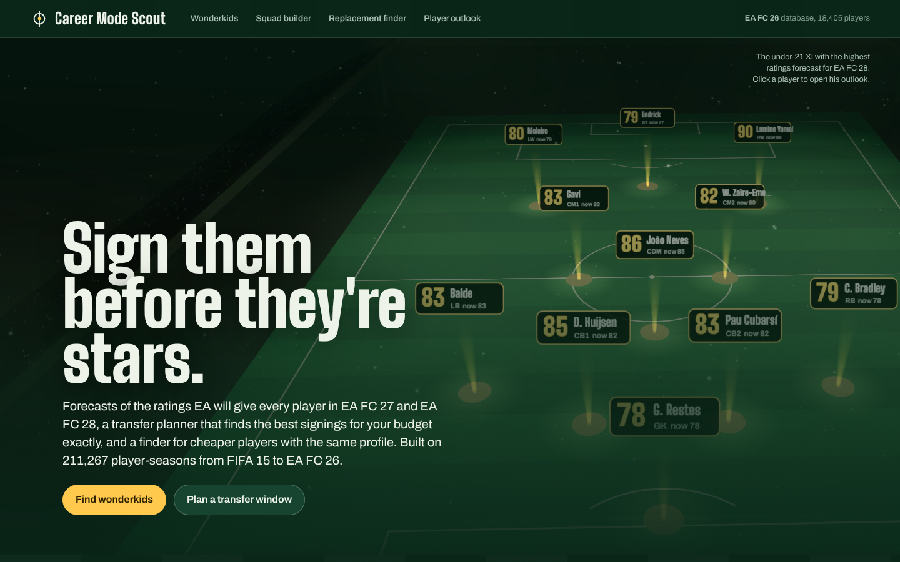
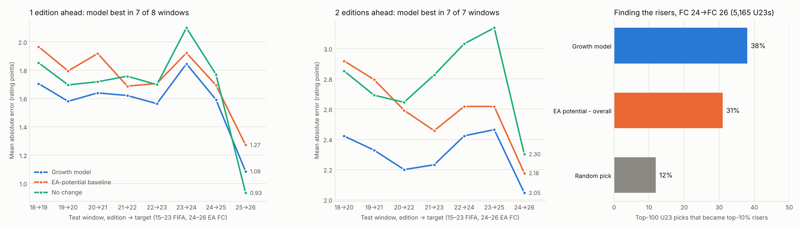

# Career Mode Scout

Data-driven transfer planning for EA FC / FIFA career mode, built on twelve editions of
player data (FIFA 15 – EA FC 26, ~211k player-seasons), served as a website with a 3D
floodlit pitch, player cards and an interactive squad builder.



Three tools, one website:

| Tool | What it answers | How |
|---|---|---|
| **Growth forecaster** | "What will this player be rated next year, and the year after?" | Gradient boosting on 136k player-season transitions, edition-based backtests |
| **Squad builder** | "Who should I buy (and sell) with €X and a wage cap to get the best XI?" | Mixed-integer program solved exactly with HiGHS, weighted by each player's chance of still being in the game, optionally steered by real transfer rumours |
| **Replacement finder** | "Who plays like my star but costs half as much?" | Similarity search over standardised attribute profiles (FAISS / NumPy) |

I built it because I play a lot of career mode and kept making transfer decisions on
gut feeling and the potential number EA shows. The question was whether a model trained
on how EA actually re-rated players over a decade could do better.

## The website

```bash
python server.py        # http://localhost:8000
```

| Page | What's on it |
|---|---|
| Home | A Three.js night match: the floodlights flicker on and the under-21 XI with the highest forecasts drops into a 4-3-3. Click a player to open his page. Below: the top risers as player cards, and the held-out results. |
| Wonderkids | Filter by age, price, position and league; rank by forecast, growth or EA potential. Cards with 3D tilt, or a table with 80% ranges. |
| Squad builder | Pick a club, budget, wage cap, formation and what you're building for (win now, balanced, or the future). You get three different plans on a perspective pitch; new signings arrive highlighted. "Not him" and "Keep him" ban or force a player, Shuffle gives a different near-best plan, and rumoured targets for your club are listed with their headlines. |
| Replacement finder | Search a player; get the closest attribute profiles under your price cap, with similarity, fee and saving. |
| Player outlook | Rating history with the two-edition forecast and its 80% band, his rating at every position on a mini pitch, attributes, contract, and look-alikes. |

Player photos are loaded straight from the image CDNs by player id, trying each source in
turn: EA's own FC 25 portraits (512 px cut-outs), then Futbin's FC 26 images (which cover
players new in FC 26), then the dataset's sofifa URL. sofifa's CDN now sits behind a
Cloudflare check that refuses images embedded on other sites, so it is only a last resort.
When no source has the player, the card shows a drawn silhouette in his rating tier colour.

**Stack.** A small JSON API (Starlette + Uvicorn) over the same Python modules the
evaluations use (`src/fcscout/service.py`), and a no-build frontend: plain ES modules,
Three.js (vendored, MIT), two OFL fonts (Big Shoulders Display, Archivo), hand-written
SVG charts. Everything is served by `server.py`, so one process or one container runs it.

## Results (all on data the models never saw)

### Growth forecaster
Test editions are held out by time: a model that predicts an edition's ratings is trained
only on transitions whose targets were known before it.

**Main test (newest targets, EA FC 26).** Bold = best in the column.

| Mean absolute error (rating points) | 1 edition ahead (FC 25 → FC 26) | 2 editions ahead (FC 24 → FC 26) |
|---|---|---|
| No change (persistence) | **0.93** | 2.30 |
| Age curve | 1.30 | 2.21 |
| **EA-potential baseline** (linear model on POT − OVR × age, fitted on the same data) | 1.27 | 2.18 |
| **Growth model** | 1.08 | **2.05** (−6% vs EA potential) |

**Every test window (rolling origin).** One test per window, each with a model trained only
on earlier editions, so no single split carries the conclusion:



Mean absolute error by test edition (bold = best of the three):

| Test edition | 1 ahead: no change | EA potential | model | 2 ahead: no change | EA potential | model |
|---|---|---|---|---|---|---|
| FIFA 18 | 1.85 | 1.97 | **1.71** | 2.85 | 2.92 | **2.42** |
| FIFA 19 | 1.70 | 1.80 | **1.58** | 2.69 | 2.80 | **2.33** |
| FIFA 20 | 1.72 | 1.92 | **1.64** | 2.65 | 2.59 | **2.20** |
| FIFA 21 | 1.76 | 1.69 | **1.62** | 2.83 | 2.46 | **2.23** |
| FIFA 22 | 1.70 | 1.71 | **1.56** | 3.03 | 2.62 | **2.42** |
| FIFA 23 | 2.10 | 1.92 | **1.85** | 3.14 | 2.62 | **2.46** |
| EA FC 24 | 1.77 | 1.69 | **1.59** | 2.30 | 2.18 | **2.05** |
| EA FC 25 | **0.93** | 1.27 | 1.08 | – | – | – |

* **One edition ahead, the model has the lowest error in 7 of 8 windows.** The
  exception is FC 25 → FC 26: the FC 25 source is a late-season roster (mid-2025) with that
  season's live upgrades already applied, so ratings barely move to FC 26's launch roster and
  "no change" is hard to beat. The model learned launch-to-launch changes. See [Data](#data).
* **Two editions ahead, the model is best in 7 of 7 windows**, by 11% on
  average against EA potential.
* **Finding the risers.** Among 5,165 players aged 23 or younger in EA FC 24, the model's
  top-100 predicted risers contained **38** of the top-10% actual two-year improvers,
  against 31 when ranking by EA's potential gap (and 12 by chance).
* The 80% prediction band covers 98% (1 edition) / 92% (2 editions) of outcomes once
  rounded to whole ratings, so it is conservative, most of all on the late-roster
  FC 25 → FC 26 window where ratings barely moved.
* Where it does not help: players 26 and older are as well served by "no change".

### Squad builder
**Exact vs. a hand-made strategy** — every Premier League club in EA FC 26 × budgets of
€20M / €50M / €100M × 4-3-3 and 4-2-3-1 (120 scenarios, max 3 signings, wage cap = current
bill + 15%). The greedy strategy repeatedly buys the biggest affordable upgrade (or the best
upgrade per euro; the better of the two is used).

* The MILP was never worse and strictly better in **68%** of scenarios.
* It added **18.6** rating points to the XI on average vs **15.0** for the best greedy plan
  (**+24%** more improvement from the same money).
* Median solver time **0.4 s** (max 2.2 s) over the full transfer market (~18k players).

**Why it used to suggest Messi.** The first version ranked signings by rating only. EA's
values collapse with age, so an 86-rated 38-year-old (€26M) was the best rating per euro,
and the forecaster never learned that veterans vanish: it only trains on players who appear
again. Run for all 20 Premier League clubs at €50M, its signings averaged **36.4** years old
(Acerbi in 16 plans, Messi in 9). With the retirement-risk model below and the three build
modes, the same runs average **35.9** (win now, by design), **29.8** (balanced, the default)
and **25.8** (build for the future). In the default mode Messi is in 1 plan (was 9) and
Acerbi in none (was 16).

**Do forecasts make better signings?** Two seasons out, yes, modestly (+2.5 XI points, interval excluding zero); one season out, no. See [Decision backtest](#decision-backtest).

### Retirement risk
Of players rated 80+, 97–99% of under-27s are still in the game two editions later, but
only 56% of 35–36-year-olds and 49% of those 37+. A gradient-boosting classifier on the same
features predicts this (`fcscout/survival.py`), tested by time like the forecaster:

| Still in the game… | Test | Model AUC | Age × rating baseline AUC | Brier (model / baseline) |
|---|---|---|---|---|
| one edition later | FC 25 → FC 26 | **0.76** | 0.71 | 0.151 / 0.161 |
| two editions later | FC 24 → FC 26 | **0.77** | 0.71 | 0.187 / 0.204 |

Its probabilities run low on the test editions: by 6–9 points for most age groups one
edition ahead and 1–7 points two ahead (it learns partly from the FC 24 → FC 25 step, where
the FC 25 game database covers fewer players). That shifts squad and market players alike,
so it changes which plan wins much less than the ordering by age, which it gets right.

### Replacement finder
* **Identity check:** taking each player's FC 25 attributes and searching the FC 26
  database, the nearest profile is the same player **92%** of the time (11,869 outfield
  players). The vectors capture who a player is, not just his rating.
* 55% of a player's 10 nearest neighbours share his primary position (12% by chance).
* For 94% of the 140 Premier League players rated 80+, it finds a same-position player
  within 3 rating points at ≤ 50% of the price: on average 66% cheaper for a
  1.9-point drop.

## Data
Every edition comes from a public GitHub copy of a sofifa.com scrape (or the game's own
database), pinned to a commit and checked by MD5 in `scripts/download_data.py`. They come
in five different layouts; `fcscout/data.py` detects each from its header and maps it to one
schema.

| Edition | Source layout | Players | Roster | Gaps filled |
|---|---|---|---|---|
| FIFA 15–20 | Kaggle "FIFA 20 complete player dataset" | 15–18k | early season | — |
| FIFA 21 | cleaned sofifa web export | 19.0k | update 6 | position ratings derived |
| FIFA 22 | Kaggle "FIFA 22 complete player dataset" | 19.2k | update 2 | — |
| FIFA 23 | sofifa export, one rating per position family | 18.4k | launch | leagues from the same club's other editions; position ratings derived |
| EA FC 24 | Playwright sofifa scrape | 18.3k | launch | ages from date of birth; card stats and position ratings derived |
| EA FC 25 | the game's database tables (players, teams, leagues, links) | 16.9k | late season (mid-2025) | values/wages for 70% estimated; card stats and position ratings derived; names from other editions |
| EA FC 26 | Kaggle "FC 26 player data" (same layout as FIFA 22) | 18.4k | launch (update 4) | — |

How the gaps are filled, and how well:
* **Card stats and position ratings** are weighted sums of the 34 detailed attributes. The
  weights were recovered by non-negative least squares on FC 26 and snapped to whole
  hundredths (EA's own grid). On FIFA 22, an edition the fit never saw, they reproduce pace
  and physical for every player, each position rating exactly for 99.6–99.96% of players
  (the rest are one point off), and the other card stats to within 0.06 points on average
  (`scripts/fit_rating_formulas.py`, `reports/rating_formulas.json`). The FIFA 23
  file's own position ratings include sofifa's boost (they exceed the player's overall), so
  they are recomputed too.
* **FC 25 values and wages** exist for the ~5.3k players in the sofifa sheet next to the
  game database. The rest are estimated by a model trained on FC 24 and FC 26 and shifted to
  match the known FC 25 players. On held-out known players: values within 20% for 99%
  (median error 2%), wages rougher (median 18%). Estimated rows are flagged
  (`money_estimated`).
* **Leagues** are named by EA's league id, because the newer files reuse short names
  ("Super League" is Swiss, Greek, Chinese and Indian).
* The game database's legend squads (Classic XI, Soccer Aid) and women's leagues are excluded.
* Ages follow the Kaggle convention: age on 1 July of the season's first year (checked on
  100% of FIFA 20, FIFA 22 and FC 26 rows).

## How it works

### Forecaster (`fcscout/features.py`, `fcscout/forecast.py`)
One row per player per edition; target = overall rating 1 or 2 editions later.
Features, all known at prediction time and present in (nearly) every edition:
age, overall, potential, gap, all 29 detailed attributes + GK attributes, card stats,
value/wage (value relative to the edition median), contract years left, loan status,
**club strength** (mean of the club's top 16), **rank in the squad and in his position group**
(a proxy for minutes), and **momentum** (rating and potential change over the last one and two
editions). Work rates were dropped when FC 25/26 were added: neither source has them.

The model is scikit-learn `HistGradientBoostingRegressor` predicting the *change* in rating with
an absolute-error loss (a median forecast; on the validation editions it beat squared error
because year-to-year shifts are skewed). Two quantile models give the 10%/90% band.
Hyperparameters are tuned on a validation edition that is also strictly earlier than the test
edition (`scripts/train_forecaster.py`, `make_splits`).

### Squad builder (`fcscout/optimize.py`)
```
maximise    Σ r[p,k]·y[p,k]                      r = the player's rating at that position
subject to  Σ_p y[p,k] = 1          every XI slot filled
            Σ_k y[p,k] ≤ x[p]       a player starts at most once, only if in the squad
            Σ fees(buys) − Σ fees(sales) ≤ transfer budget
            Σ wages(final squad) ≤ wage budget
            #buys ≤ max signings,  #sales ≤ max sales,  squad size and depth per position
            x, y binary
```
`r` is the player's position rating (a striker at LW is rated as a LW), optionally plus the
forecast change. Outside "win now" it is an **expected** rating: with `s` the chance the
player is still in the game and `b` the squad's backup level at that slot,
`r' = s·r + (1 − s)·min(b, r)`, which keeps the program linear. The modes:

| Mode | Plans on | Stay probability |
|---|---|---|
| Win now | today's ratings | — |
| Balanced (default) | average of the next two forecasts | average of the one- and two-edition ones |
| Build for the future | the forecast two editions out | two-edition |

**Variety.** Plans B and C add a constraint that the previous plans' exact sets of signings
can't be repeated (`Σ x ≤ |S| − 1` for each earlier set `S`), so each is the best plan that
differs from the ones before. "Not him" removes a player, "Keep him" forces one in
(`x = 1`). Shuffle adds a random preference of up to 1.5 rating points per player to the
objective only, so the plan is always within 0.4 XI points of the best and the reported
ratings stay true. **Realism:** players at clubs more than 3 points stronger (mean of the
best 16) are left out, since they rarely move down; rumoured or kept players are exempt.

The full market is too large to hand to the solver directly (~200k binaries hit the time
limit), so it is reduced with two rules that provably cannot remove the optimum:
1. a signing rated below the (11 + max sales)-th best squad option at a slot never needs to
   start there — one of those squad players is always free to take the slot;
2. a player beaten on every slot rating, fee and wage by at least *max signings* others in his
   position group can always be swapped for one of them.

This leaves roughly 1–2.5k candidates; a plan takes about a second including the pruning.
With earlier plans excluded, rule 2 needs *max signings + excluded plans* dominators to stay
exact. The unit tests check the result against brute-force enumeration on random small
instances: with and without sales, and with expected ratings, objective bonuses, kept and
removed players, and excluded plans.

### Transfer rumours (`fcscout/rumours.py`, `scripts/fetch_rumours.py`)
Every two months (`.github/workflows/rumours.yml`, 1st of Jan/Mar/May/Jul/Sep/Nov) a GitHub
Action searches two free sources that allow automated access and can be searched over a
date range, so nothing in between is missed:
* the **GDELT** news index (one search per club, for the 80 strongest clubs, last 70 days);
* **The Guardian's** football transfer-window articles over the same window.

Only headline, link, outlet and date are kept, never article text. Each headline is
matched to players in the newest edition (full names always; a surname alone only for
well-known players nobody else in the database shares) and to clubs (database names plus
nicknames such as "Man Utd" and "Spurs"). The player's own club is the seller; other clubs
named are suitors, unless the headline says *from* them. Denials ("reject", "rule out"),
outgoing news ("open to selling") and contract news are skipped. Each player–club link is
scored `1 − exp(−Σ outlet weight × stage × recency)`: outlets from 1.0 (The Athletic, BBC)
down to 0.2 for tabloids; stage 1.0 for "agreed / medical", 0.8 for "bid / talks", 0.5 for
"interest / target"; recency halves every 45 days. With "Favour rumoured players" on, a linked
player gets up to +3 rating points in the objective for that club.

### Replacement finder (`fcscout/similar.py`)
Players are vectors of their 29 outfield attributes (keepers: GK attributes plus a few
relevant others), z-scored and L2-normalised; inner product = cosine similarity. Search is
exact — FAISS `IndexFlatIP` when installed, otherwise the same computation in NumPy — then
filtered by position, fee, age, rating and league.

## Decision backtest
Does planning with the forecast lead to better signings? For each test window, 40 clubs
(top-16 average 68–78) get €30M, 3 signings and a 4-3-3. Signings are chosen three ways —
on today's position ratings (**now**), with the EA-potential baseline's predicted change
(**potential**), and with the growth model's (**forecast**) — using models trained only on
earlier editions. Each plan is then scored with the **actual** ratings one or two editions
later: the best XI the final squad can field (players who left the game are unavailable).
The windows are the same as in the first version of this project (inside FIFA 15–22), so
the numbers stay comparable. All four variants that were run are reported.

| Variant (windows) | Clubs | Forecast − now, XI points [95% CI] | Forecast − potential | Signing age (now / pot. / fc.) | Signings gone from the game (now / pot. / fc.) |
|---|---|---|---|---|---|
| 1 season (FIFA 18, 19) | 76 | +0.7 [-0.1, +1.6] | +0.0 | 33.1 / 32.1 / 32.8 | 31 / 29 / 32 |
| 1 season, signings ≤ 29 | 76 | +0.1 [-0.5, +0.7] | -0.5 | 27.9 / 27.1 / 27.7 | 43 / 42 / 48 |
| 2 seasons (FIFA 18, 20) | 74 | +2.5 [+0.7, +4.3] | -0.5 | 33.3 / 29.7 / 31.8 | 109 / 88 / 91 |
| 2 seasons, signings ≤ 29 | 74 | +1.6 [-0.7, +4.4] | -3.1 | 28.2 / 22.2 / 24.9 | 44 / 35 / 56 |

What this says, plainly:
* **One season ahead, forecasts don't change the outcome.** Rating changes for established
  players are small, so all three methods mostly buy the same players, and both intervals
  include zero.
* **Two seasons ahead, planning with the forecast beats planning on current ratings:**
  +2.5 XI points, with a 95% interval of +0.7 to +4.3 that excludes zero. With signings
  capped at 29 the gain is smaller (+1.6) and no longer certain.
* **The simple potential baseline did as well or better than the growth model here**
  (−0.5 and −3.1 XI points for the forecast two seasons out), even though the model predicts
  individual ratings more accurately. The largest single loss over two seasons is signings
  who leave the game (retire or move to unlicensed leagues); the forecaster is trained only
  on players who stay, so it does not price that risk.

That retirement-risk model now exists and the website plans on expected ratings (see
[Retirement risk](#retirement-risk)); this decision backtest has not yet been rerun with it,
so its effect on the "gone from the game" column is still to be measured.

## Limitations
* **It forecasts EA's next-edition ratings, not in-save growth.** In a career-mode save,
  growth is driven by the game's hidden dynamic potential and playing time. The forecaster
  answers "who will EA rate higher next year", which tracks real-life development. The squad
  builder and replacement finder work directly on in-game ratings.
* **Snapshot timing differs by edition** (table above). The late-season FC 25 roster shrinks
  FC 25 → FC 26 changes; this is why one-edition-ahead "no change" wins that window.
* **FC 25 money is mostly estimated**, and FC 24/25 have no loan information.
* **Survivorship.** Targets exist only for players still in the next edition (~70% per year);
  players who retire or leave licensed leagues are not in the error numbers.
* **Rumours are matched to a roster that is a season old.** EA FC 26 ratings are from its
  launch (Sept 2025), so a player who moved in summer 2026 is still listed at his old club.
  Matching is tuned for precision, so some rumours are missed rather than mismatched;
  each linked player shows his headlines so you can judge them.
* Prices are value × a markup you choose, capped by the release clause. Real AI clubs
  negotiate; free agents are left out because these files have no wage data for them.

## Quickstart
```bash
python -m venv .venv && source .venv/bin/activate
pip install -r requirements.txt
python scripts/run_all.py --quick     # download, build, train, evaluate (a few minutes)
python server.py                      # http://localhost:8000
```
`python scripts/run_all.py` also runs the optimizer backtests (about an hour).
`python scripts/fetch_rumours.py` refreshes the rumour feed by hand (a few minutes; set
`GUARDIAN_API_KEY` for the Guardian's full rate limit, otherwise its public test key is used).
Tests: `python -m pytest -q`.

**Deploy.** `Dockerfile` builds the data and models at image build time and serves on
port 7860, so it runs unchanged on Hugging Face Spaces (Docker SDK), Render, Railway or Fly.io:
```bash
docker build -t career-mode-scout . && docker run -p 7860:7860 career-mode-scout
```

## Layout
```
server.py                  web server: JSON API + the site in web/
web/                       the site (ES modules, CSS, Three.js scene, fonts, vendored Three.js)
src/fcscout/data.py        loaders for every source layout -> one schema, gap filling
src/fcscout/features.py    player-season panel, features and targets
src/fcscout/forecast.py    growth model, baselines, evaluation
src/fcscout/optimize.py    MILP squad builder + greedy baseline
src/fcscout/survival.py    chance a player is still in the game 1 or 2 editions later
src/fcscout/rumours.py     headline -> (player, club, stage) matching and scoring
src/fcscout/similar.py     replacement finder
src/fcscout/service.py     everything the website asks for, as plain functions
scripts/                   download, build, train, backtests, figures, rating formulas
reports/                   metrics (JSON/CSV) and figures from the last run
rumours/rumours.json       the transfer-rumour feed (refreshed every two months by GitHub Actions)
tests/                     unit tests (incl. brute-force optimality), API and server tests
```

Data: sofifa.com and EA Sports, via the public repositories pinned in
`scripts/download_data.py`: the Kaggle datasets by Stefano Leone (CC0) and rovnez
(FC 26), and GitHub projects by tmclouisluk, Ruzsel, abineshta, MithileshAnavkar,
stephensoccer, Radzim and ismailoksuz. Not affiliated with EA Sports.
